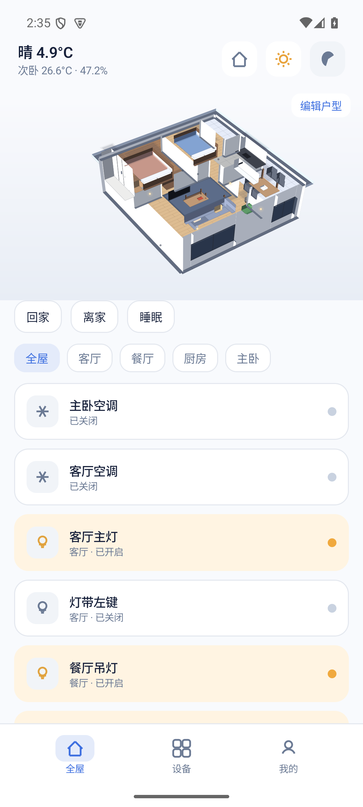
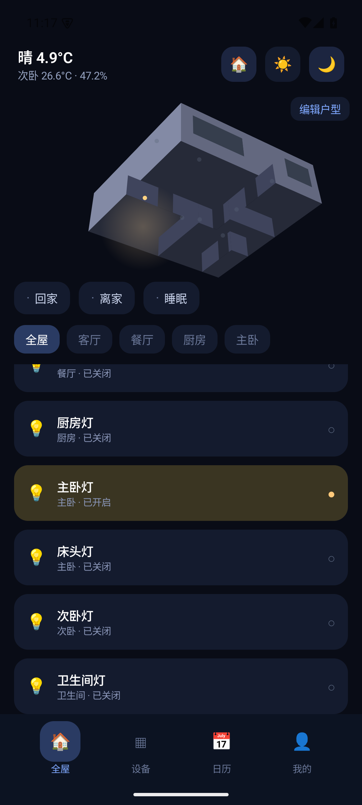
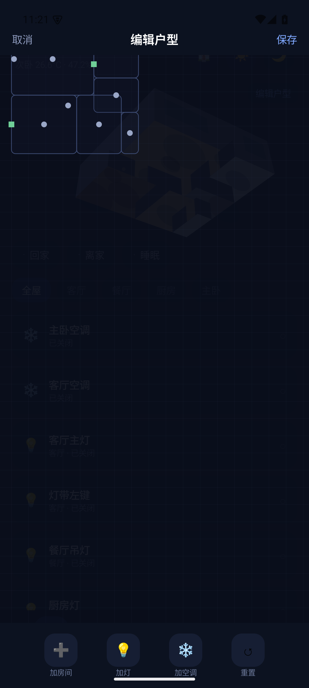

<div align="center">

# 🏠 HomeMate

**安卓原生的 3D 智能家居面板 — 你的家，一座会发光的数字孪生**

Kotlin · Jetpack Compose · 自研 3D 渲染引擎 · 零第三方依赖

</div>

---

## 📸 截图

| 白天 ☀ | 黑夜 🌙（主卧灯已开） |
| --- | --- |
|  |  |

| 户型编辑器 ✏️ |
| --- |
|  |

灵感来自 [0xProbabillity/house-control](https://github.com/0xProbabillity/house-control)（Mac/iOS 的 3D 户型控制面板）。
house-control 没有安卓版本，于是有了 HomeMate —— 把同样的「JSON 户型 + 3D 场景 + 灯光即照明」体验带到安卓上。

## ✨ 功能

### 🌗 3D 数字孪生
- **真 3D 户型渲染**：自研轻量引擎（透视投影 + 面法线光照），单文件不到 500 行，无 WebGL / Three.js 依赖
- **昼夜一键切换**：
  - ☀ 白天 — 暖色地板、太阳方向光照亮墙面、家具投影
  - 🌙 黑夜 — 环境变暗、已开灯具在地板投下暖色光晕、窗户透出室内光
  - 切换带 smoothstep 缓动动画
- **手势交互**：拖动旋转视角（方位角 + 仰角），**直接点击 3D 场景里的灯**开关它
- **自动挖洞**：外墙按 openings 数据自动生成门窗洞，窗户带透光玻璃

### ✏️ 户型编辑器
- 平面画布 + 网格，**拖拽新建房间**（画个矩形就行）
- 选中房间 / 灯 / 空调：**拖动移动、改名、删除**
- 工具栏一键加灯、加空调（挂到房间后可拖到任意位置）
- 一键重置回示例户型

### 📱 App 界面
- **全屋**：3D 户型 + 场景快捷（回家/离家/睡眠）+ 房间筛选 + 设备卡片
- **设备**：全屋设备列表，实时同步状态
- **日历 / 我的**：入口与设备统计
- 深蓝夜色主题，对照真实智能家居 UI 还原

### 🔌 数据格式
户型就是一个 JSON 文件（`files/plans/plan.json`），字段与 house-control 的
[plan 格式](https://github.com/0xProbabillity/house-control/blob/main/docs/floor-plan.md) 兼容：

```jsonc
{
  "name": "我的家",
  "wallHeight": 2.6,
  "rooms":    [{ "id": "living", "name": "客厅", "rect": [0, 0, 4.8, 4.2], "floor": "oak" }],
  "openings": [{ "type": "window", "from": [0.6, 0], "to": [3.2, 0] }],
  "furniture":[{ "type": "sofa", "pos": [2.4, 1.1], "rot": 180 }],
  "lights":   [{ "id": "living.main", "name": "客厅主灯", "room": "living", "type": "ceiling", "pos": [2.4, 2.1] }],
  "acs":      [{ "id": "living.ac", "name": "客厅空调", "room": "living", "pos": [4.8, 2.4] }]
}
```

坐标单位为米，`x` 向右、`z` 向下、`y` 向上。内置两室一厅示例，开箱即可玩。

## 🏠 对接 Home Assistant

「我的 → Home Assistant」填入服务器地址和长期访问令牌即可启用。

**设备映射**：编辑 plan.json，给灯和空调加 `entity` 字段绑定 HA 实体：

```jsonc
"lights": [{ "id": "living.main", "entity": "light.living_room", ... }],
"acs":    [{ "id": "bed1.ac", "entity": "climate.bedroom", ... }]
```

绑定后的行为：
- App 内开关灯 / 调温 → 实时调用 HA 的 `light.turn_on/off`、`climate.set_temperature`
- HA 侧任何变动（自动化、其他客户端）→ WebSocket 推送到 App，3D 场景和列表实时更新
- 未绑定的设备继续本地模拟，互不影响

## 📲 安装

从 [Releases](../../releases) 下载 `HomeMate-debug.apk` 传到手机安装（允许未知来源），或：

```bash
adb install HomeMate-debug.apk
```

系统要求：Android 8.0（API 26）及以上。

## 🔨 从源码构建

```bash
git clone https://github.com/CottonChou/homemate.git
cd homemate
export JAVA_HOME=$(/usr/libexec/java_home -v 17)
export ANDROID_HOME=$HOME/Library/Android/sdk
gradle assembleDebug        # 产物在 app/build/outputs/apk/debug/
```

## 🗂 代码结构

```
app/src/main/java/com/caidongzhou/homemate/
├── Plan.kt         户型数据模型 + JSON 读写 + 内置示例
├── Floor3D.kt      3D 渲染引擎（投影 · 光照 · 昼夜 · 阴影 · 光晕）
├── HomeView.kt     3D 交互视图（旋转手势 · 点灯命中）
├── PlanEditor.kt   户型编辑器（平面画布 · 手势编辑 · 工具栏）
├── PlanStore.kt    plan.json 存取
└── MainActivity.kt Compose UI（四 Tab · 夜色主题）
```

## 🗺 Roadmap

- [x] Home Assistant 对接（REST / WebSocket，灯与空调映射到实体）
- [ ] 语音入口（本地语音识别 + 意图控制设备）
- [ ] 户型导入 / 导出、分享
- [ ] 更多家具类型与材质
- [ ] 平板 / 折叠屏自适应布局

## 🙏 致谢

- [0xProbabillity/house-control](https://github.com/0xProbabillity/house-control) — 架构与 plan 格式灵感
- [Mastershort/neonplan3d](https://github.com/Mastershort/neonplan3d) — 同类 HA 3D 户型卡片

## License

MIT
