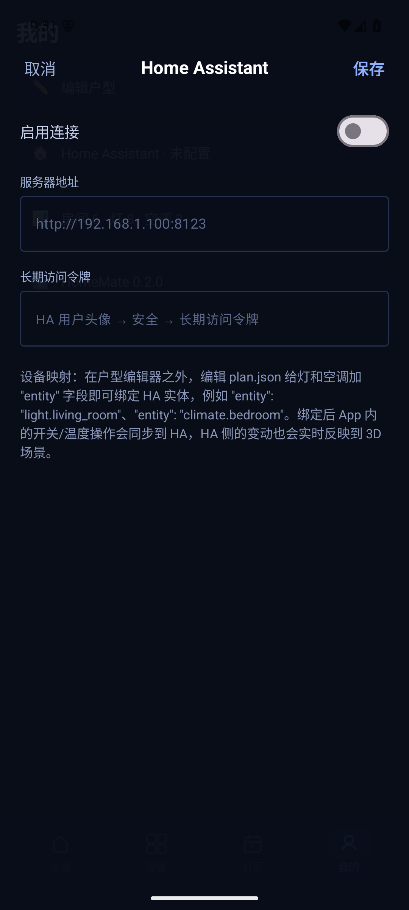
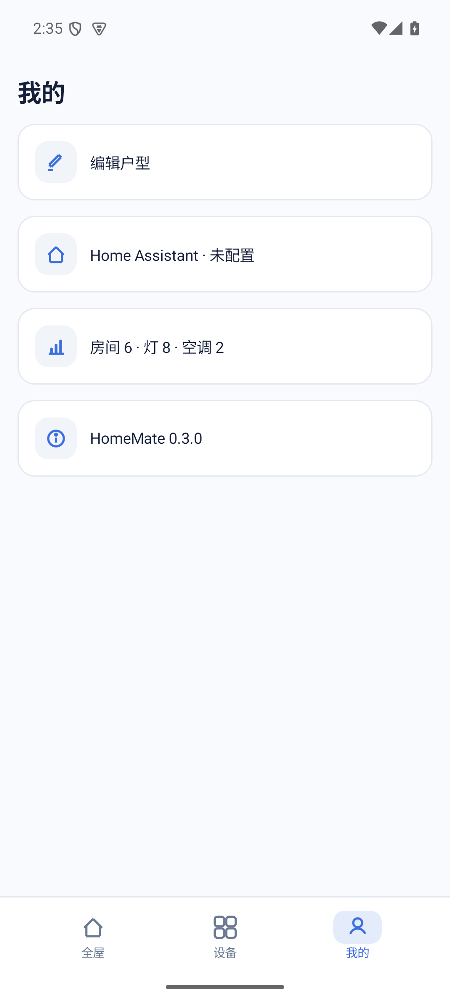

<div align="center">

# HomeMate

**安卓原生的 3D 智能家居面板**

Kotlin · Jetpack Compose · 自研 3D 渲染 · Home Assistant REST / WebSocket

</div>

---

## 截图

| 全屋 · 白天 | 全屋 · 黑夜 |
| --- | --- |
|  |  |

| 户型编辑器 | Home Assistant | 我的 |
| --- | --- | --- |
|  |  |  |

## 项目简介

HomeMate 是一个可直接运行在 Android 手机上的 Home Assistant 控制面板。
它把户型数据、家具、门窗、灯光和空调组合成一个可旋转、可点击的 3D 数字孪生，
并提供白天与夜晚两套完整界面。

项目参考了 [0xProbabillity/house-control](https://github.com/0xProbabillity/house-control)
的「JSON 户型 + 3D 场景 + 灯光即照明」思路，但采用 Kotlin 与 Jetpack Compose 从零实现
Android 版本，不依赖 WebView、Three.js 或第三方 3D 引擎。

## 主要功能

### 3D 户型

- 建筑剖面式视角：远侧保留完整墙体，近侧自动削成矮墙，室内布局始终可见
- 低多边形风格：墙体、地板、家具都用大色块表达，不叠加木纹、砖缝等高频噪声
- 墙体带真实厚度与明亮墙顶，窗户是一整段浅色玻璃带，不做窗棂碎件
- 模型带薄底座和柔和落地阴影，像一座摆在桌面上的建筑模型
- 床、沙发、餐桌、厨房、衣柜、电视、书桌、绿植、浴缸等家具用一到三个体块概括
- 自动按模型投影边界适配画布，竖屏、横屏和不同户型都不会缩成一个小角落
- 支持拖动旋转视角和俯仰角，点击 3D 场景中的灯可直接开关

### 昼夜与光影

- 白天：近白背景与白色控件，场景按接近原色的高明度光照渲染，地板保持暖木色
- 夜晚：深蓝场景、冷色环境光，已开灯具在下方投出暖色光池，未开灯房间保持暗调
- 昼夜切换带平滑过渡动画，状态栏图标同步切换明暗
- 家具在白天带柔和接触阴影，夜晚由实际开灯状态参与照明计算

### 户型编辑器

- 平面网格画布自动居中并适配当前户型
- 拖拽空白区域平移视图，双击画布重新居中
- 新建房间、添加灯、添加空调
- 选中房间或设备后可拖动、改名或删除
- 编辑器使用低饱和房间底色、深色标签和简洁线性工具图标

### 设备控制

- **全屋**：3D 户型、场景快捷入口、房间筛选和设备状态卡片
- **设备**：按房间查看灯与空调的集中列表
- **我的**：户型编辑入口、Home Assistant 配置和家庭设备统计
- 底部导航只保留全屋、设备、我的三个入口

### Home Assistant 对接

- 在「我的 → Home Assistant」填写服务器地址和长期访问令牌
- `plan.json` 中的灯和空调支持 `entity` 字段绑定 HA 实体
- App 操作通过 REST 调用 `light.*` 与 `climate.*` 服务
- HA 状态变化通过 WebSocket `state_changed` 事件实时回写 App
- 未绑定实体的设备继续作为本地模拟设备运行

## 户型数据

户型是纯 JSON，运行时保存在 App 的
`files/plans/plan.json`，结构兼容 house-control 的 plan 格式：

```jsonc
{
  "name": "我的家",
  "wallHeight": 1.30,
  "interiorWallHeight": 0.62,
  "camera": { "azimuth": 30, "elevation": 50 },
  "rooms": [
    { "id": "living", "name": "客厅", "rect": [0, 0, 4.8, 4.2], "floor": "oak" }
  ],
  "openings": [
    { "type": "window", "from": [0.6, 0], "to": [3.2, 0], "sill": 0.45, "head": 1.30 }
  ],
  "furniture": [
    { "type": "sofa", "pos": [2.4, 1.1], "rot": 180, "width": 2.4 }
  ],
  "lights": [
    {
      "id": "living.main",
      "name": "客厅主灯",
      "room": "living",
      "type": "ceiling",
      "pos": [2.4, 2.1],
      "entity": "light.living_room"
    }
  ],
  "acs": [
    {
      "id": "living.ac",
      "name": "客厅空调",
      "room": "living",
      "pos": [4.8, 2.4],
      "entity": "climate.living_room"
    }
  ]
}
```

坐标单位为米：`x` 向右、`z` 向下、`y` 向上。

## Home Assistant 设备映射

在户型 JSON 中为设备添加 `entity`：

```jsonc
"lights": [
  { "id": "living.main", "entity": "light.living_room" }
],
"acs": [
  { "id": "bed1.ac", "entity": "climate.bedroom" }
]
```

支持的设备类型：

| HomeMate | Home Assistant |
| --- | --- |
| 灯 | `light.*` |
| 空调 | `climate.*` |

App 会将本地操作推送到 Home Assistant，同时订阅 WebSocket 状态推送。

## 安装

从 [Releases](../../releases) 下载 `HomeMate-0.3.1.apk`（release 签名版），传到手机后允许未知来源安装。

也可以通过 ADB：

```bash
adb install HomeMate-0.3.1.apk
```

系统要求：Android 8.0（API 26）及以上。

## 从源码构建

```bash
git clone https://github.com/CottonChou/homemate.git
cd homemate

export JAVA_HOME=$(/usr/libexec/java_home -v 17)
export ANDROID_HOME=$HOME/Library/Android/sdk

gradle assembleRelease
```

APK 输出：

```text
app/build/outputs/apk/release/app-release.apk
```

发布签名从根目录的 `keystore.properties` 读取（该文件与 `*.jks` 不入库）；
没有该文件时会自动回退到 debug 签名，因此仓库克隆下来依然可以直接构建。

## 代码结构

```text
app/src/main/java/com/caidongzhou/homemate/
├── Plan.kt             户型模型、JSON 读写、内置示例
├── Floor3DRenderer.kt  自研 3D 投影、墙体、家具、材质与光照
├── HomeView.kt         3D 画布手势与点击命中
├── PlanEditor.kt       2D 户型编辑器
├── PlanStore.kt        本地户型文件存储
├── Theme.kt            白天 / 夜晚配色
├── HaClient.kt         HA REST 控制与 WebSocket 连接
├── WsFrames.kt         最小 WebSocket 帧实现
├── HaSettings.kt       HA 配置与实体状态映射
├── HaSettingsScreen.kt HA 设置页面
└── MainActivity.kt     Compose 主界面与底部导航
```

## 当前版本

`v0.3.1`

- 重写 3D 投影：修正竖直方向，家具不再被自身底座遮挡
- 3D 风格收敛为低多边形建筑剖面模型，去掉地板纹理与零碎家具细节
- 墙体、地板、家具改为大色块，窗户改为整段玻璃带
- 白天改为近白背景 + 高明度光照，夜晚改为冷色环境光 + 暖色光池
- Home Assistant 设置页跟随主题，白天为浅色表单
- 版本号改为读取构建信息，避免与安装包不一致
- 重新拍摄 README 全部截图

## 致谢

- [0xProbabillity/house-control](https://github.com/0xProbabillity/house-control) — 户型 JSON 与控制面板思路
- [Mastershort/neonplan3d](https://github.com/Mastershort/neonplan3d) — 同类 Home Assistant 3D 户型项目

## License

MIT
